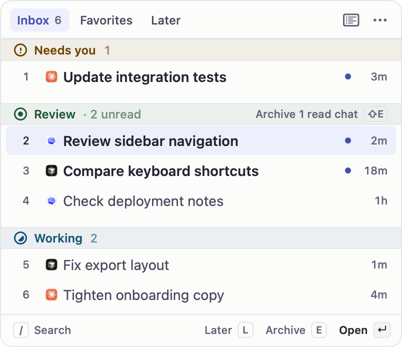

# Side Eye

Side Eye is a macOS menu bar app that puts your agent chats from Codex, Claude Code, Cursor and Grok Bot in one list at the edge of your screen. It shows which agents need you, which have finished and which are still working, and one key takes you to the right chat.



## Install

Side Eye needs macOS 14 or later and runs on Apple silicon and Intel.

With Homebrew:

```sh
brew tap jan-ebb/side-eye https://github.com/Jan-ebb/side-eye
brew install --cask side-eye
```

Or download `SideEye-x.y.z.zip` from [Releases](https://github.com/Jan-ebb/side-eye/releases), unzip it and move Side Eye.app to Applications.

Side Eye is not yet notarized by Apple, so macOS blocks it the first time you open it, whether it came from Homebrew or from the download. Open it once and close the warning. Then go to **System Settings → Privacy & Security**, scroll down to the line about Side Eye and click **Open Anyway**. You do this once after installing and once after each update. On macOS 14 you can Control-click Side Eye.app and choose **Open** instead.

If you prefer Terminal, this clears the block in one step:

```sh
xattr -dr com.apple.quarantine "/Applications/Side Eye.app"
```

A copy you build yourself is not blocked.

To build it yourself, install Xcode or its command-line tools and run:

```sh
git clone https://github.com/Jan-ebb/side-eye.git
cd side-eye
./Scripts/package.sh "/Applications/Side Eye.app"
```

## First run

Side Eye has no Dock icon. It lives in the menu bar and as a small pill on the right edge of your screen. The first time you open it, a welcome window shows which apps it found, how to open the sidebar and what its three statuses mean. You can reopen it from the menu bar icon under **Welcome to Side Eye…**.

- Hover the pill, or press ⌃⌥Space from any app, to open the sidebar.
- Side Eye opens at login from its first launch, so it is back after a restart. Untick **Open Side Eye at login** in the welcome window, or turn off **Open at login** in Settings, to stop that.
- Side Eye needs no permissions to start. Opening a Claude Code chat that runs in a terminal asks for Automation access once, so Side Eye can switch to the right tab.
- Summaries are optional. The welcome window and **Settings → Summaries** offer to download the model, 1.1 GB, once.
- If the Inbox is empty, it says why: no supported app was found, or none has a chat yet.
- **Settings → Apps** shows how many chats the last scan found for each app.

## Privacy

Side Eye reads each app’s local files on your Mac to list its chats. It sends nothing anywhere: it has no account and collects no analytics. The only time it goes online is to download the summary model, and only when you press **Download**. Summaries then run on that model on your Mac through a private socket, so no chat text leaves it.

## Using Side Eye

Open Settings from the sidebar’s more button or the Side Eye menu bar icon.

Drag the edge pill up or down to dock it at a different height. Side Eye saves its position on each display. Hover to grow the pill into the sidebar, and move away to shrink it back. Side Eye uses native Force Touch feedback on reveal and after a drag settles. Its animations follow the system Reduce Motion setting.

The sidebar opens with one line per chat. Press **D** or use the preview button to add a preview under every chat: its latest summary, or where it runs until a summary exists. Press **D** again to hide them all. Side Eye remembers your choice.

## Switching

| Shortcut | Action |
| --- | --- |
| ⌃⌥Space | Open or close the sidebar from any app. |
| ⌘K, or ⌃⌥K from any app | Open the command palette. Type a chat’s name to switch to it, or a command to run it. Each command shows its key. |
| / | Search the current list. Results are one flat list, best match first, and Return opens the top one. |
| 1–9 | Open rows 1–9 from top to bottom. |
| 0 | Jump to any numbered row. Type the number, then press Return. |
| D | Show or hide previews. |
| E | Archive the selected chat. |
| ⇧E | Archive every reply you have already read, in one step. Z undoes it. |
| R | In Archive, restore the selected chat to the Inbox. |
| L | Move the selected chat to Later, or back to the Inbox from the Later list. |
| F | Favorite the selected chat, or unfavorite it. P works too. |
| H | Later until a time: in an hour, this evening, tomorrow morning or next week. The chat comes back by itself, marked unread. |
| J / K | Move down or up, like ↓ and ↑. |
| Z | Undo the last move. ⌘Z works too. |
| ⌥↑ / ⌥↓ | Jump to the previous or next group. |
| Tab | Switch between Inbox, Favorites and Later. |

Single keys act on the list when Side Eye is open. Letters are commands, so typing only searches after / or inside ⌘K. Opening Side Eye with a keyboard shortcut shows it instantly; hovering the pill grows it out of the edge. See **Settings → Shortcuts** for shortcuts that work from other apps.

Side Eye has two views. The **Inbox** is where you triage: it groups chats by what the agent is doing, **Needs you**, **Review** and **Working**, each newest first, with a tinted header that stays pinned while you scroll. Reading a chat never moves it. Titles come in two styles: bold with a dot when there is something new for you, plain otherwise. Reading a chat only makes its row plain. A reply you have read stays under Review until you archive it. The Review header says how many replies are unread and offers **Archive N read chats** (⇧E) for the rest. A chat moves only when its agent asks, finishes or starts a turn, or when you archive it or move it to Later. Idle chats stay out of the Inbox; search and ⌘K still find them, and new activity brings them back. When nothing needs you, the list says so at the top. **Favorites** is the lasting list of chats you keep coming back to. Favorite a chat with F, the star that replaces its time on hover, ⌘K or the right-click menu. It keeps its place in the Inbox, and Favorites lists it in the order you added it until you unfavorite it, even after you archive it or its app stops reporting it. Up to 30. **Later** is one list ordered by when chats come back, soonest first; a chat with a return time shows it beside an alarm, and one saved without a time keeps its usual timestamp. Press H to give a chat a return time. Chats in Later stay out of the attention count and nudges. A chat leaves Later when you move it back, when its return time comes, or when its agent does something new: finishes a turn, starts one or asks for input. One you moved to Later while its agent was working comes back when that run ends. Status shows once per view, always in words: group headers in the Inbox, and the status written on each row in Favorites, Later, search results and ⌘K. Each tab shows how many chats it lists. The active tab stays selected between sidebar openings.

Use Up and Down as soon as the sidebar opens, including on hover. The next chat to act on is selected when the sidebar opens, so Return opens it: a new input request first, then an unread reply. The bar under the list shows the keys that list is for: Later, Archive and Open in the Inbox, Unfavorite in Favorites, Restore in Archive. After you archive a chat or move it to Later, the same bar offers Z to undo it. Use ⌘U to mark read or unread. Escape exits search or closes the sidebar. Choose **Show Archive** from the Side Eye menu bar icon, or **Go to Archive** in ⌘K, to browse archived chats. Press R there to restore the selected chat. An archived chat comes back by itself, unread, when its agent finishes a new turn, starts one or asks for input, so long-lived chats such as Cursor projects never hide new work. A chat you archive while its agent is still working comes back when that run ends. Add a chat URL from the same menu bar icon.

A newly completed turn or input request produces a quiet edge nudge. The edge pill shows the number of chats that still need attention. Pending input requests count until they’re resolved or archived, even after you read them.

Row numbers follow the displayed order. Review rows show the age of their last completion. Other rows show the age of their latest reported activity. Hover on a row to see its status, the full local date and time and its summary when available.

**Needs you** stays visible while a decision or answer is pending. That covers a request made in the middle of a run, such as an approval or a question dialog, in every app. For Claude Code chats in the Claude app it also covers a reply that ends with a question for you: the reply shows under Review when it finishes and moves to Needs you a moment later, once Claude has noted that it is waiting on you. **Review** holds work the agent has handed back; unread ones are new. **Working** marks an active turn reported by the app. Grok Bot keeps no running flag on disk, so Side Eye reads the end of each transcript. A Grok chat counts as working while a request waits for its first answer (up to 10 minutes for yours, 15 for one from another agent), for 5 minutes after a short first reply or a progress note such as “The search is running”, and for 20 seconds after any other message, because agents usually send several in a row. **Idle** means the app has reported no new update or request, and **Inactive** marks idle chats with eight hours without reported activity. **Read** means you opened an update in Side Eye, marked it read, or its app marked it read. A read reply stays in Review, dimmed, until you archive it; Grok Bot and Cursor report it as read rather than idle.

**Summarize recent chat text** uses a local model to write one sentence about the latest request, result, and any supported next action. Side Eye reads bounded excerpts from the apps’ local caches and keeps the summary in memory. The model runs only when needed and shuts down when idle. Rows rely on what the app itself reports when a recent transcript is absent.

Completion and input nudges show the same sentence. If it finishes after the nudge appears, Side Eye adds it to the visible card.

## Apps

| App | Discovery and signals | Switching |
| --- | --- | --- |
| Codex desktop | Up to 32 non-archived chats active in the last 24 hours. Completion and read state come from local history. Input requests use the installed app’s live status when available. | Exact thread link |
| Claude Code | Live Desktop and terminal sessions, plus available CLI background jobs. Working, waiting, and completion come from the session registry and CLI. | Exact Desktop link or terminal TTY. Terminal switching can require macOS Automation access. Ghostty needs 1.4 or later for TTY lookup. |
| Cursor | Local agent chats and cloud agents active in the last 48 hours. Status comes from available generation, approval, and unread fields. | Exact local or cloud agent link |
| Grok Bot | Agent chats active in the last 48 hours. The local roster supplies unread replies and requests for input. | Exact agent link. The roster identifies the agent even when an unread reply is in one of its subthreads. |

Side Eye scans local metadata about every four seconds and keeps archived chats and app settings in local preferences. Changes to apps’ local formats can affect discovery or state reporting.

To show only your main Grok Bot agents, open **Settings → Apps**, choose **Main only** next to **Agents shown** under Grok Bot, and check as many agents as you like. An agent you create later is shown by itself unless you turn off **Show new agents automatically**. Each app in the list says how many chats the last scan found, or why it found none. The list holds every agent in Grok Bot, including archived ones and ones with no recent chat. The sidebar shows a **Main** badge on your marked agents.

Scheduled Codex automation runs are hidden by default. Turn on **Include scheduled automation runs** under Codex in **Settings → Apps** to include them in the sidebar, attention count, and nudges.

## Build and check

`Scripts/package.sh` builds Side Eye.app for this Mac. `Scripts/release.sh` builds the download: a universal app, zipped, with its checksum in `dist/`. Pushing a tag such as `v0.16.0` that matches the `VERSION` file runs the release workflow, which publishes the zip as a GitHub release and points the Homebrew cask at it. With a Developer ID in the repository secrets listed in [the workflow](.github/workflows/release.yml), the release is signed and notarized.

To check a build, run:

```sh
./Scripts/package.sh "/path/to/Side Eye.app"
"/path/to/Side Eye.app/Contents/MacOS/SideEye" --self-test
"/path/to/Side Eye.app/Contents/MacOS/SideEye" --ui-check
"/path/to/Side Eye.app/Contents/MacOS/SideEye" --diagnostics
```

The diagnostics report counts, route availability, and the number of summaries generated locally. A newly built copy can report none generated on its first one or two runs: its server is still compiling GPU code when the report prints. Run it again. Run the UI check with the main app closed so it can register the same shortcuts. Add `--pointer-check` to test the real global shortcut and pointer hover, which briefly moves the pointer.

Summaries are optional. The release download has no model inside. Press **Download** under **Settings → Summaries** and Side Eye fetches the pinned weights named in [the model notes](ModelLicenses/SideEyeSummary.md), 1.1 GB from Hugging Face, checks them against the SHA-256 given there and keeps them in `~/Library/Application Support/Side Eye/Models`. A file that fails the check is deleted, and Settings can remove the model again. The model runs on [llama.cpp](https://github.com/ggml-org/llama.cpp), whose server the release download carries inside the app. Side Eye starts it on demand and talks to it over a private Unix socket. The very first summary on a Mac takes about 15 seconds longer on Apple silicon, while macOS prepares the model’s GPU code; after that it is cached.

A copy you build yourself has no server inside and uses Homebrew’s (`brew install llama.cpp`). To put one in, install cmake (`brew install cmake`), run `./Scripts/llama-server.sh /tmp/llama-server` and set `SIDE_EYE_LLAMA_SERVER=/tmp/llama-server` when running the packaging script. That script fetches llama.cpp at a pinned commit and builds its server with nothing left to load from Homebrew. `./Scripts/release.sh` does both steps. To build a copy with the model inside as well, set `SIDE_EYE_SUMMARY_MODEL` to the verified GGUF file.

[Linear’s design refresh](https://linear.app/now/behind-the-latest-design-refresh), [Mobbin’s navigation references](https://mobbin.com/blog/how-to-use-mobbin-mcp), and the [Wispr Flow edge bar](https://docs.wisprflow.ai/articles/1790396454-move-and-dock-the-flow-bar-on-desktop) informed the overlay. [Codex deep links](https://learn.chatgpt.com/docs/reference/commands#deep-links) and the [Claude Code agent view](https://code.claude.com/docs/en/agent-view#read-session-state-from-a-script) document the underlying entry points.

## License

[MIT](LICENSE).
